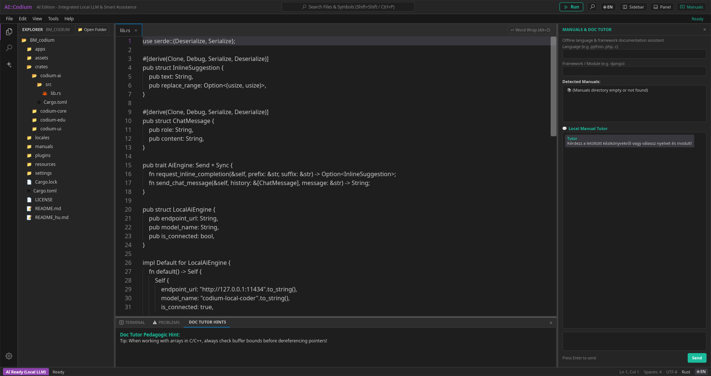

# BM::Codium [AI | EDU]

[](https://www.rust-lang.org/)
[](https://github.com/lapce/floem)
[](https://www.gnu.org/licenses/agpl-3.0.html)
[](LICENSE)
[](Binary_Size)
[](Status)

> High-performance native Rust IDE platform blending the ergonomics of **VS Code**, the hardware-accelerated speed of **Zed**, the clean architecture of **Floem**, and the beloved productivity features of **JetBrains** (Search Everywhere, Run Gutter).


*This is just the beginning. Plenty of room for improvement and further development...*

---

## Hungarian Documentation

A részletes magyar nyelvű leírásért tekintsd meg a [README_hu.md](README_hu.md) fájlt!

---

## Project Status

| Metric                  | Details                                                                           |
| :---------------------- | :-------------------------------------------------------------------------------- |
| **Engine Architecture** | 100% Pure Rust (`BM_codium` workspace), Floem 0.2 GPU engine, Xi-Rope text buffer |
| **Telemetry & Bloat**   | **Zero telemetry, Zero Electron, 100% offline vendored crates**                   |
| **Primary Platforms**   | **Linux (Wayland & X11)** (Tested & Verified); Windows & macOS planned            |

---

## Beginning and Idea

My **BSc final exam** was on **12 June 2026**, so the very next day I decided to build something truly useful for universities and students...  
This project is called: **EDU::Codium**. It is an educational code editor tailored not just for learning programming languages, but for school assignments, laboratory sessions, university coursework, and above all: **administering quizzes, tests, and exam tasks**.  
It is **AI-free**: code completion is disabled by default so that students genuinely learn how to program. Furthermore, it includes features for instructors to create assignments and manage courses. Built on the **Floem** GUI framework, it is inspired by **Zed**, **Lapce**, **Lite-XL**, and above all **VSCodium** (sharing a kindred name).  

Alongside it lives **AI::Codium**, the counterpart edition tailored for advanced software engineers and researchers with integrated, offline local LLM capabilities.

---

## Two Dedicated Editions

| Feature               | 🎓 EDU::Codium (`edu-codium`)                                        | ✦ AI::Codium (`ai-codium`)                                  |
| :-------------------- | :------------------------------------------------------------------- | :---------------------------------------------------------- |
| **Target Audience**   | Universities, High Schools, Students, Teachers, Exams                | Professional Developers, Researchers                        |
| **Generative AI**     | **Strictly Disabled** (prevents cheating, enforces genuine learning) | **Enabled** (Ghost-text completions, LLM chat)              |
| **Code Completion**   | **Teacher-Configurable** (disabled by default, „ac”-token mode)      | Full AI & LSP Autocomplete                                  |
| **Educational Tutor** | **Doc Tutor & Hint Explainer** (explains errors pedagogically)       | AI Explanations & Refactoring suggestions                   |
| **Teacher Policy**    | Configurable via `.codium-edu.toml` (exam mode, lock downs)          | Standard user settings                                      |
| **Binary Size**       | **standalone native binary** (see the badge above)                   | **standalone native binary**                                |
| **Startup Time**      | **planned to be near-instant** (Rust, lightweight and fast)          | **planned to be near-instant** (Rust, lightweight and fast) |

---

## Supported Programming Languages

Tailored to the demands of university computer science curricula, engineering courses, and professional software development across **18 key programming languages**, along with direct out-of-the-box support for static web, serverless-web, stylesheets, "read-me" files/books, command shells, and configuration formats (23 technologies total):

| Language / Technology | Category                                | File Extensions                        | Recommended LSP                    | Gutter Run (▶) & Doc Tutor Highlights                                                        |
| :-------------------- | :-------------------------------------- | :------------------------------------- | :--------------------------------- | :------------------------------------------------------------------------------------------- |
| **Python**            | Dynamic / Scripting                     | `.py`, `.pyw`                          | `pyright` / `jedi-language-server` | Direct interpreter runner (`python3`), file I/O & context manager reference cards.           |
| **PHP**               | Dynamic / Web                           | `.php`, `.phtml`                       | `intelephense` / `phpactor`        | CLI script runner (`php`), array manipulation & web backend cheat sheets.                    |
| **Rust**              | Systems / Native                        | `.rs`                                  | `rust-analyzer`                    | `cargo run` integration, ownership/borrowing memory model cards, `Result`/`Option` handling. |
| **C**                 | Systems / Low-level                     | `.c`, `.h`                             | `clangd`                           | `gcc`/`clang` build & run, pointer arithmetic, manual memory management (`malloc`/`free`).   |
| **C++**               | Systems / OOP                           | `.cpp`, `.hpp`, `.cc`, `.cxx`          | `clangd`                           | `g++`/`clang++` compile, RAII, STL containers, smart pointers reference.                     |
| **C#**                | Enterprise / .NET                       | `.cs`                                  | `OmniSharp` / `csharp-ls`          | `dotnet run`, LINQ query syntax, OOP architecture, async/await patterns.                     |
| **Java**              | Enterprise / JVM                        | `.java`                                | `jdtls` (Eclipse JDT)              | `javac` & `java` runner, OOP principles, JVM collections hierarchy.                          |
| **Kotlin**            | JVM / Modern                            | `.kt`, `.kts`                          | `kotlin-language-server`           | `kotlinc` runner, null safety features, data classes, coroutines.                            |
| **Erlang**            | Functional / Concurrent                 | `.erl`, `.hrl`                         | `erlang_ls`                        | `erlc` compile & `erl` shell, actor model, pattern matching, message passing.                |
| **Scala**             | JVM / Functional OOP                    | `.scala`, `.sc`                        | `metals`                           | `scala` CLI runner, immutable data structures, pattern matching, traits.                     |
| **Elixir**            | Functional / BEAM                       | `.ex`, `.exs`                          | `elixir-ls` / `expert`             | `elixir` runner, pipeline operator (`\|>`), OTP supervision, fault tolerance.                |
| **Go**                | Systems / Cloud                         | `.go`                                  | `gopls`                            | `go run` execution, goroutines & channels concurrency, interface contracts.                  |
| **TypeScript**        | Web / Typed JS                          | `.ts`, `.tsx`                          | `typescript-language-server`       | `tsx`/`node` execution, type inference, interfaces, generics reference cards.                |
| **JavaScript**        | Serverless-web (JS) / Scripting         | `.js`, `.mjs`, `.cjs`                  | `quick_lint_js` / `ts-server`      | `node`/`yarn`/`pnpm`/`bun`/`deno` execution, async/await, DOM API & fetch() cheat sheets.    |
| **Ruby**              | Dynamic / Scripting & Web               | `.rb`, `.rake`, `Gemfile`              | `solargraph` / `ruby-lsp`          | `ruby` execution, blocks, gems, metaprogramming & Rails cheat sheets.                        |
| **Zig**               | Systems / Modern C Alternative          | `.zig`                                 | `zls`                              | `zig run` / `zig build`, compile-time execution (`comptime`), manual memory control.         |
| **Swift**             | Native / Apple & Server-side            | `.swift`                               | `sourcekit-lsp`                    | `swift run` / `swift`, ARC memory management, optionals, protocol-oriented design.           |
| **Objective-C**       | Native / Legacy macOS & iOS             | `.m`, `.mm`                            | `clangd`                           | `clang` build, message-passing (`[target action]`), legacy Cocoa compatibility.              |
| **HTML / XML**        | Static Web / Markup                     | `.html`, `.htm`, `.xml`, `.svg`        | `html-languageserver` / `lemminx`  | Built-in preview, DOM tree structure & closing tag helpers.                                  |
| **CSS / SCSS**        | Stylesheets / Web Design                | `.css`, `.scss`, `.sass`, `.less`      | `css-languageserver`               | Flexbox, CSS Grid & custom properties cheat sheets, color swatches.                          |
| **Markdown & TeX**    | "Read-me" Files / Books                 | `.md`, `.rst`, `.asc`, `.tex`          | `marksman` / `texlab`              | Live Markdown preview, LaTeX formula compiling, technical docs cheat sheets.                 |
| **Shell & Scripts**   | Command Shells (shell, batch, cmd, ps1) | `.sh`, `.bash`, `.bat`, `.cmd`, `.ps1` | `bash-language-server`             | Direct terminal execution (▶), POSIX Shell, Windows Batch & PowerShell syntax cards.         |
| **Config & SQL**      | Database & Configuration                | `.toml`, `.sql`, `.ini`, `.json`       | `taplo` / `sqls` / `json-ls`       | SQL query execution, schema validation, key-value & formatting cheat sheets.                 |

---

## Supported Platforms

| Platform    | Display Server / Graphics              | Status                 | Notes                                                                                             |
| :---------- | :------------------------------------- | :--------------------- | :------------------------------------------------------------------------------------------------ |
| **Linux**   | Wayland & X11 (WGPU / Vulkan / OpenGL) | **Supported (Tier 1)** | Primary target. Hardware-accelerated GPU rendering, tested on Wayland & X11 desktop environments. |
| **Windows** | Win32 / DirectX 12 / Vulkan            | *Planned (Tier 2)*     | Floem cross-platform windowing pipeline ready; packaging in progress.                             |
| **macOS**   | Metal / Cocoa                          | *Planned (Tier 2)*     | Apple Silicon (M-series) and x86_64 target builds planned.                                        |

---

## Key Ergonomics & User Interface

BM::Codium combines the best UX innovations from modern IDEs into a unified, zero-bloat environment:

1. **VS Code Familiarity**:
   - **Activity Bar**: Left vertical vector icon strip with active indicator accent.
   - **Desktop Menubar**: Traditional and intuitive top menu system (File, Edit, View, Tools, Help) with floating foreground dropdowns and keyboard shortcuts.
   - **Primary Sidebar**: Collapsible file explorer with folder trees and language badges.
   - **Tabbed Editor**: Multiple split-ready document tabs with active/inactive contrast and dirty state dots (`●`).
   - **Bottom Dock**: Multi-tab panel hosting Terminal, Problems diagnostics, and Doc Tutor pedagogic hints/outputs.
   - **Status Bar**: Clean footer with cursor coordinates (`Ln, Col`), Encoding (`UTF-8`), Spaces indent, and Language mode.
   - **VSCodium Keybindings**: Standard, customizable `keybindings.json` profiles with Hungarian QWERTZ / QWERTY layout tolerance and AltGr normalization.

2. **JetBrains Productivity Features**:
   - **Search Everywhere (`Shift + Shift` / `Ctrl + P`)**: Central titlebar pill allowing universal search across files, symbols, and actions (toggleable via the View menu or titlebar).
   - **Gutter Run Button (▶)**: Direct compile and run execution from the titlebar or right next to code entry points (`main()`).
   - **Quick Documentation (`F1` / Doc Tutor)**: Instant access to standard library cheat sheets and syntax cards.

3. **Pure Native Rust & Floem**:
   - **Zero Electron / Zero Web Bloat**: Runs on bare metal with hardware-accelerated GPU rendering via WGPU and Taffy flexbox.
   - **Xi-Rope Text Engine**: B-tree text buffer with instant open/edit performance on files of any size.
   - **Vector SVG Icons**: Clean, scalable Codicons embedded natively without emoji fallbacks.

4. **Bilingual Localization (EN / HU)**:
   - **Default Language**: English (`EN`) as the international academic standard.
   - **Parallel Hungarian (`HU`) Support**: Instant runtime language switching via the `🌐 EN / HU` toggle in the titlebar, statusbar, or Tools menu (powered by GNU gettext `.po` catalogs).

---

## Project Architecture

The project is structured as a modular Rust Cargo workspace:

```text
BM_codium/
├── Cargo.toml                # Workspace definition & optimized dev/release profiles
├── .cargo/config.toml        # Offline vendored crate resolution (vendor-offline)
├── settings/                 # Dedicated configuration folder:
│   ├── settings.json         # User and environment settings
│   └── keybindings.json      # VSCodium keybinding shortcuts profile
├── crates/
│   ├── codium-core/          # Xi-Rope buffer, undo/redo, file trees, i18n locale engine
│   ├── codium-edu/           # University policies (.codium-edu.toml), DocTutor, error explainer
│   ├── codium-ai/            # Local LLM traits, inline ghost-text completion provider
│   └── codium-ui/            # Floem layout: titlebar, activity bar, sidebar, tabs, bottom panel
└── apps/
    └── codium-app/           # Binary runners:
        ├── src/bin/ai_codium.rs   -> ai-codium executable
        └── src/bin/edu_codium.rs  -> edu-codium executable
```

---

## Building and Running

### Prerequisites

- Rust compiler (`rustc >= 1.86`, tested on `rustc 1.95.0`)
- Standard Linux GUI libraries (Wayland / X11, standard C library)

### Build Executables (Offline)

```bash
cargo build --offline --bin edu-codium --bin ai-codium
```

The resulting binaries will be placed in `target/debug/` (or `target/release/` for optimized production):

- `target/debug/edu-codium`
- `target/debug/ai-codium`

### Launch

```bash
# Launch University Educational Edition
./target/debug/edu-codium

# Launch with a specific file or folder
./target/debug/edu-codium /path/to/project

# Launch AI Edition
./target/debug/ai-codium
```

---

## University Policy Configuration (`.codium-edu.toml`)

Teachers can drop a `.codium-edu.toml` file into their assignment repositories:

```toml
# University course configuration
institution_name = "Computer Science Department - BSc"

# Strictly disable generative AI code-writing
allow_ai_generation = false

# Teacher-controlled token autocompletion
allow_kite_completion = false

# Enable pedagogic documentation and hint cards
doc_tutor_enabled = true

# Offline exam mode (blocks network calls)
exam_mode = true
```

---

## Feedback & Contributing

We actively welcome feedback, ideas, and contributions from university professors, students, and open-source software engineers:

- **University Curricula & Exam Policies**: If you are a faculty member interested in custom exam lockdown modes or `.codium-edu.toml` profiles, feel free to submit ideas.
- **Doc Tutor Cheatsheets**: Help expand offline pedagogic cards, syntax examples, and compiler error explainers for the 18+ supported languages and formats.
- **Ergonomics & Performance**: Share your thoughts on keyboard shortcuts, Search Everywhere indexing, and gutter run integrations.
